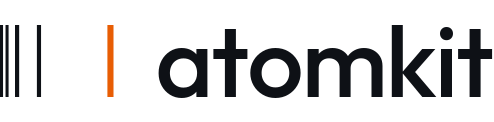

atomkit runs the atomic-structure codes (FAC, GRASP, AUTOSTRUCTURE, MCDFGME, JAC, pCI and others)
from one input, reads every code's output into the same tables, and writes them in the formats that
databases and modelling codes read.

atomkit is shared with researchers who want to test it and contribute, while it is prepared for an open release.

**To test it and contribute, fill in the [form](../../issues/new?template=request-access.yml).** You need a GitHub
account. Each form is read by hand; GitHub then emails you an invitation.
